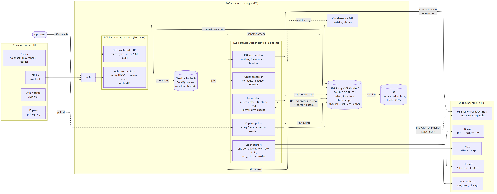

# Order & Inventory Sync Service: Design

*Ankit Bisht · MARS Cosmetics Software Engineer take-home · October 2026*

**Summary:** a NestJS modular monolith on ECS Fargate, with **PostgreSQL as the only source of truth**. Stock is reserved by a conditional `UPDATE` in the same transaction as the order, the audit ledger and the ERP outbox, so a unit can't be sold twice and no side effect is lost. Each channel gets **absolute, coalesced quantities** at its own rate limit, minus a **lag-based buffer**.

## 1. Architecture



| Runs where | What it does |
|---|---|
| **ECS Fargate `api`** (2–6 tasks behind an ALB) | Webhooks: verify HMAC, store the raw event, reply 200, enqueue. Also the ops dashboard and its API. |
| **ECS Fargate `worker`** (2–8 tasks; scales on queue depth) | Order processor, Flipkart poller, one stock pusher per channel, ERP sync, reconcilers. |
| **RDS PostgreSQL** (Multi-AZ, `t4g.medium`) | Orders, inventory, ledger, push state, outbox. All correctness lives here. |
| **ElastiCache Redis** (`t4g.small` + replica) | BullMQ queues and per-channel token buckets. Losing it delays work but never loses data. |
| **S3, CloudWatch + SNS** | Raw-payload archive and Blinkit CSVs; alarms to Slack/email. |

It is one codebase deployed as two services, because 3 developers and about 5 orders/s at peak don't justify microservices. Isolation comes from a separate queue, rate limiter and circuit breaker per channel, each channel being an adapter behind one `ChannelAdapter` interface. **Cost is about ₹35k/month** (on-demand estimates: RDS ₹11.5k, Fargate ₹8.5k, Redis ₹4.5k, NAT ₹4k, ALB ₹2k, other ₹3.5k), about 30% under budget.

## 2. Data model

| Table | Key columns | Constraints / purpose |
|---|---|---|
| `inbound_event` | channel, dedup_key, payload jsonb, status | **UNIQUE(channel, dedup_key)**. Replayable raw copy; the key is the channel's event id, or a payload hash. |
| `orders` | channel, external_order_id, status, last_event_time, totals | **UNIQUE(channel, external_order_id)**. Status is a forward-only state machine. |
| `order_lines` | order_id, sku, qty, unit_price, line_status | qty > 0. Status: RESERVED, SHORT, CANCELLED, SHIPPED or RETURNED. |
| `inventory` | sku PK, on_hand, reserved, version | **CHECK(0 ≤ reserved ≤ on_hand)**. available = on_hand − reserved. |
| `stock_ledger` | sku, Δon_hand, Δreserved, reason, ref_id, after-values, actor, time | Append-only; **UNIQUE(reason, ref_type, ref_id)**. Answers "why did stock change, and when?" |
| `channel_stock` | channel, sku, desired qty/version, pushed qty/version, priority, error | PK(channel, sku). *Dirty* when desired_version > pushed_version. |
| `erp_outbox` | order_id, kind (CREATE/CANCEL), status, attempts, next_attempt_at | UNIQUE(order_id, kind). |
| `channel_listing`, `channel_cursor` | channel SKU id ↔ our sku, min_buffer; poll cursor | UNIQUE(channel, channel_sku_id). |

**Stock lifecycle (one ledger row each):** `ORDER_RESERVE` (reserved +q); then either `ORDER_RELEASE` on cancel (back on sale at once) or `ORDER_SHIP` on dispatch (on_hand and reserved both −q); then `RETURN_RESTOCK` after QC (on_hand +q). GRNs and adjustments are polled from BC's item ledger every 5 min.

**Duplicates are stopped three times:**
1. The raw-event key catches exact redeliveries.
2. The order key catches the same order arriving as a different event.
3. The ledger key means a reprocess can't reserve twice: the transaction fails.

## 3. Order ingestion

- **Webhooks: persist, then acknowledge.** Insert the raw event with `ON CONFLICT DO NOTHING`, reply 200 in under 100 ms, then enqueue. If Postgres is down we return 503 and the channel retries; we never acknowledge an event we haven't stored. A normalisation bug parks the event as FAILED rather than losing it.
- **Polling (Flipkart).** One job instance every 2 min fetches orders updated since `cursor − 5 min`. The overlap absorbs late orders and dedup drops repeats, and the cursor moves only after a page commits. Polling shares Flipkart's token bucket with pushing (2 of 10 req/s).
- **Duplicates and out-of-order events.** `SELECT … FOR UPDATE` on the order row serialises its events. They feed a forward-only state machine: `PENDING → RESERVED | ON_HOLD → SHIPPED → DELIVERED`, with `CANCELLED` and `RETURNED` terminal. Backward moves are ignored. A `CANCELLED` that arrives before `CREATED` leaves a cancelled *tombstone*, so the late `CREATED` does nothing; the end state is the same in any arrival order.
- **Channel down or missed webhooks.** Every 15 min a reconciler re-reads each channel's recent orders through the same dedup path, so webhooks are only the fast path. A down channel backs up only its own queue (§7 alerts on silence).

## 4. Inventory consistency: two channels sell the last unit in the same second

Each order line is reserved with one statement, inside the transaction that creates the order ([pseudo-code](design/reservation.md)):

```sql
UPDATE inventory SET reserved = reserved + :qty, version = version + 1
 WHERE sku = :sku AND on_hand - reserved >= :qty RETURNING on_hand, reserved, version;
```

`MRS-LIP-104` has on_hand 50 and reserved 49. A Nykaa webhook and a Flipkart poll each bring a 1-unit order at 11:04:52.

| # | Worker A: Nykaa order | Worker B: Flipkart order |
|---|---|---|
| 1 | Insert order + line. `UPDATE` takes the row lock; 50 − 49 ≥ 1 ✓, so reserved becomes 50 | Insert order + line. `UPDATE` **blocks** on A's lock |
| 2 | Insert ledger row, set the 4 `channel_stock` rows to 0, insert outbox row, `COMMIT` | |
| 3 | | Lock granted. Postgres **re-checks the WHERE on the committed row**: 50 − 50 ≥ 1 ✗, so 0 rows |
| 4 | | Line SHORT, order ON_HOLD, no ERP row, `COMMIT`; ops alert |
| 5 | Pushers send 0 at top priority: website at once, Nykaa and Blinkit in about 1 s, Flipkart within 10 s | |

- **Exactly one order wins, decided by lock order.** There is no distributed lock, and the CHECK constraint stops even a code bug.
- **Sorted SKU locking** means multi-line orders can't deadlock.
- **Contention is negligible.** A row lock lasts about 2–5 ms, so 5 orders/s on one SKU keeps it locked under 3% of the time.
- **This is the worst case.** With buffers, Flipkart would normally be showing 0 by now.

**The real risk is staleness.** Flipkart can sell for about 2.5 min before we see the order, and every channel shows the last value we pushed. So channels show `max(0, available − buffer)`, where `buffer = max(min_buffer, ⌈velocity × lag⌉)`. *Velocity* is the SKU's sales per minute across channels over the last 15 min. *Lag* is about 0 for the website, 0.5 min for Nykaa and Blinkit, and 2.5 min for Flipkart. A SKU selling 20/min hides its last 50 units from Flipkart and its last 10 from Nykaa, so the final units go to the channels we update fastest. We trade a few lost sales on slow channels for fewer cancellations, which hurt seller ratings. On normal days buffers fall to `min_buffer` (0–2 units).

## 5. Stock push within 60 s

Every stock change sets the desired values in `channel_stock` in the same transaction. One pusher per channel takes dirty rows in priority order: **P0** (shown quantity hit 0 or entered the buffer), **P1** (back in stock), then **P2** (everything else, oldest first). It sends the **current absolute value**, then records `pushed_version` only if nothing newer has arrived. Ten changes between pushes become one call, and no database lock is held during HTTP.

| Channel | Limit | Strategy | Capacity |
|---|---|---|---|
| Website | none | Push every change | unlimited |
| Nykaa | 5 req/s, 1 SKU per call | 4 req/s token bucket | **240 SKUs/min** |
| Flipkart | 10 req/s, 50 SKUs per call, 429 | Batch every 10 s at 8 req/s | 24,000 SKUs/min |
| Blinkit | REST (assumed 5 req/s) + CSV | REST intraday; full CSV nightly | about 240 SKUs/min |

**Sale peak:** 300 orders/min × 1.7 lines is about 500 changes/min, concentrated on the 100–300 SKUs in the sale. After coalescing, only Nykaa and Blinkit are tight. P0 and P1 updates land within seconds; low-risk P2 updates (480 → 478) may slip past 60 s at the very peak, which the buffer covers. **On a 429** we honour `Retry-After` and pause that channel's bucket; the rows stay dirty.

## 6. Failure handling

- **Retries.** Transient errors (timeout, 5xx, 429) retry with exponential backoff and jitter, 5 s up to 15 min. Permanent errors (4xx, unknown SKU) go to FAILED at once. Every task is a Postgres row, and a sweeper re-enqueues anything stuck for over 5 min, so a Redis wipe only delays work.
- **ERP exactly once**, done as at-least-once delivery plus idempotency.
  - The outbox row is written in the reserving transaction. Workers claim rows with `FOR UPDATE SKIP LOCKED`.
  - Each order carries the BC **External Document No. = channel + external order id**. Before creating, and after a timeout (waiting at least 2 min first), the worker looks it up and marks the row DONE if the order already exists.
  - CANCEL runs after CREATE, or replaces it if CREATE was never sent.
  - A nightly check flags duplicate document numbers.
- **ERP Sunday downtime.** A circuit breaker opens after 5 failures and probes every 2 min. Jobs are **paused, not failed**, so they keep their retry attempts. Selling never waits on the ERP. A backlog of about 700–1,000 orders drains in order in about 4 min.
- **Blinkit timeouts (2%).** 3 s timeout. A timed-out row stays dirty and is re-sent with the latest value; if the first call landed, the repeat sets the same number. Three timeouts in a row is about 1 in 125,000, and the nightly CSV resets any drift.
- **Messages that keep failing go DEAD, which shows them on the ops screen** with payload, error and attempts. A DEAD row never blocks others; if Nykaa dies, only Nykaa's dirty set grows, capped at 1,200 rows. Actions: **Retry**, **Retry filtered**, **Mark resolved** (with a note).

## 7. Observability: day-one alerts

| Metric | Alert when |
|---|---|
| Short-order rate (failed reservations ÷ orders, 15 min) | Over 0.2%, an early warning for the 0.5% target |
| Push lag per channel (oldest dirty row) | A P0 row is over 60 s old, or any row over 5 min |
| ERP backlog and dead letters | Oldest PENDING over 30 min outside maintenance, or any DEAD row |
| Ingestion freshness per channel | No orders for 30 min in business hours, or 3 failed Flipkart polls |
| Stock drift (nightly: ledger vs inventory, ours vs BC) | Any mismatch |

## 8. Scope: left out of v1

- **Auto-cancelling short lines on channels.** Ops does it from an alert queue; each cancel API adds risk.
- **Reserve-at-checkout holds on our website.** The best fix for website oversell, but it needs website work (v1.1).
- **Forecast-based allocation, bundles, multi-warehouse, price and catalogue sync.**
- **Kafka, microservices, multi-region.** Unnecessary at 5 orders/s and over budget.

**6-week plan:** weeks 1–2 schema, ledger, reservation, website and Nykaa; weeks 3–4 Flipkart, Blinkit, pushers, ERP; week 5 ops screen, alerts, reconcilers; week 6 concurrency and 3× load tests, plus a shadow run against the spreadsheet.

## 9. Trade-offs

| Decision | Chose | Rejected | Why |
|---|---|---|---|
| Reservation | Postgres conditional UPDATE + CHECK, in one transaction with order, ledger and outbox | Redis Lua counters; Redlock | 5 orders/s is trivial for Postgres, and one ACID transaction keeps stock, audit and outbox consistent. Redis would be a second source of truth. |
| Shape | Modular monolith, 2 deployments | A microservice per channel | 3 developers, 6 weeks. Per-channel isolation inside the worker contains faults just as well. |
| Queue | BullMQ backed by a Postgres outbox | SQS; Kafka/MSK | Redis is already in the stack, and the outbox makes losing Redis a delay. MSK is costly overkill. |
| Push | Absolute, coalesced desired state | One delta per change | Idempotent, order-insensitive, bounded backlog. Deltas double-apply on retry. |
| Oversell | Lag-based buffers | Full stock everywhere | A cancellation hurts seller rating more than a lost sale at the end of stock. |

## 10. Assumptions

- Channels give stable order ids, sign their webhooks, retry on non-2xx, and offer a "list recent orders" API.
- Marketplaces accept an absolute stock quantity and decrement it on each sale. Flipkart's 10 req/s covers polling and push together.
- Blinkit REST takes 1 SKU per call at up to 5 req/s; its CSV is a full snapshot.
- BC is the system of record for physical stock. Its GRNs, shipments and returns can be read incrementally, External Document No. is searchable, and it accepts at least 5 req/s.
- "Confirmed" means fully reserved and not cancelled; COD counts as prepaid. Returns restock only after QC. Channels allow cancelling individual lines. No bundles; about 1.7 lines per order.
- Single region (ap-south-1); ops sign in with Google SSO; secrets live in Secrets Manager.

## 11. Stretch A: a second warehouse in Bengaluru

`inventory` and `stock_ledger` gain a `warehouse_id`, making each warehouse its own pool with its own buffers. Reservation tries the warehouse that serves the pincode first, then the other, using the same conditional UPDATE and keeping the same race guarantee. Channels with location-level stock (Blinkit) get per-warehouse quantities; the others see the sum. BC orders carry a Location Code, transfers are ledger rows, and stock in transit isn't sellable.

---
**AI usage:** I used Claude (via Claude Code) to stress-test options, tighten the wording and generate the Mermaid diagram. I reviewed every decision and own it.
