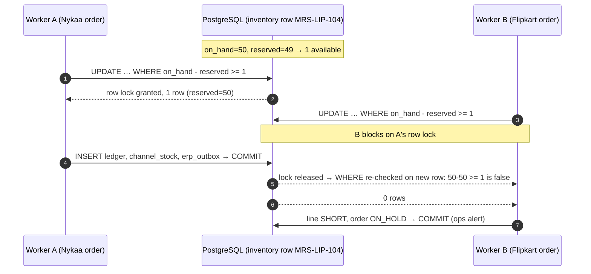

# Stock reservation: pseudo-code

This is the optional pseudo-code for question 4 of [DESIGN.md](../DESIGN.md). It is TypeScript-flavoured, in the shape a NestJS service would have, with SQL inline. Every function runs in one PostgreSQL transaction at the default `READ COMMITTED` isolation level.

## The race in one picture



## 1. ORDER_CREATED

```ts
async function handleOrderCreated(evt: CanonicalOrder): Promise<void> {
  await db.tx(async (tx) => {
    // 1. Idempotency. One row per (channel, external_order_id). Locking it
    //    serialises every event for this order.
    await tx.none(`
      INSERT INTO orders (id, channel, external_order_id, status, last_event_time, payment_mode, pincode, total_amount)
      VALUES (gen_random_uuid(), $1, $2, 'PENDING', $3, $4, $5, $6)
      ON CONFLICT (channel, external_order_id) DO NOTHING`, [...]);
    const order = await tx.one(`
      SELECT * FROM orders WHERE channel = $1 AND external_order_id = $2 FOR UPDATE`, [evt.channel, evt.externalOrderId]);

    // Already handled: a duplicate webhook, a re-polled order, or a CANCELLED
    // event that arrived first and left a tombstone.
    if (order.status !== 'PENDING') return;

    // 2. Reserve each line. Sorting by SKU means two multi-line orders always
    //    lock rows in the same order, so they can't deadlock.
    let short = false;
    for (const item of sortBy(evt.items, 'sku')) {
      const line = await tx.one(`
        INSERT INTO order_lines (order_id, sku, qty, unit_price, line_status)
        VALUES ($1, $2, $3, $4, 'PENDING') RETURNING id`, [order.id, item.sku, item.qty, item.unitPrice]);

      // The whole concurrency story is this one statement. Postgres takes a row
      // lock; a concurrent transaction waits, then re-evaluates the WHERE
      // against the committed row. CHECK (reserved <= on_hand) is the backstop.
      const inv = await tx.oneOrNone(`
        UPDATE inventory
           SET reserved = reserved + $2, version = version + 1, updated_at = now()
         WHERE sku = $1 AND on_hand - reserved >= $2
        RETURNING sku, on_hand, reserved, version`, [item.sku, item.qty]);

      if (!inv) {                       // lost the race, or really out of stock
        await tx.none(`UPDATE order_lines SET line_status = 'SHORT' WHERE id = $1`, [line.id]);
        short = true;
        continue;                       // keep the other lines; the customer still wants them
      }

      await tx.none(`UPDATE order_lines SET line_status = 'RESERVED' WHERE id = $1`, [line.id]);

      // 3. Audit trail. UNIQUE(reason, ref_type, ref_id): reserving the same
      //    line twice violates the constraint and rolls back the transaction.
      await tx.none(`
        INSERT INTO stock_ledger (sku, delta_on_hand, delta_reserved, reason, ref_type, ref_id,
                                  on_hand_after, reserved_after, actor)
        VALUES ($1, 0, $2, 'ORDER_RESERVE', 'order_line', $3, $4, $5, 'order-processor')`,
        [inv.sku, item.qty, line.id, inv.on_hand, inv.reserved]);

      // 4. Desired state for every channel. Pushers pick this up (see section 4).
      await markChannelStockDirty(tx, inv);
    }

    // 5. Outbox. Only fully reserved ("confirmed") orders go to the ERP.
    if (short) {
      await tx.none(`UPDATE orders SET status = 'ON_HOLD' WHERE id = $1`, [order.id]);
    } else {
      await tx.none(`UPDATE orders SET status = 'RESERVED' WHERE id = $1`, [order.id]);
      await tx.none(`
        INSERT INTO erp_outbox (order_id, kind, status, next_attempt_at)
        VALUES ($1, 'CREATE', 'PENDING', now()) ON CONFLICT (order_id, kind) DO NOTHING`, [order.id]);
    }
  });

  // After COMMIT, nudge the workers. If this nudge is lost (crash, Redis down),
  // the sweeper finds the PENDING rows within 5 minutes. Nothing depends on it.
  await queues.nudge('erp-sync', 'stock-push');
}
```

## 2. ORDER_CANCELLED (and out-of-order arrival)

```ts
async function handleOrderCancelled(evt: CanonicalOrderEvent): Promise<void> {
  await db.tx(async (tx) => {
    // If CREATED hasn't arrived yet, this leaves a CANCELLED tombstone, and the
    // late CREATED becomes a no-op.
    await tx.none(`
      INSERT INTO orders (id, channel, external_order_id, status, last_event_time)
      VALUES (gen_random_uuid(), $1, $2, 'CANCELLED', $3)
      ON CONFLICT (channel, external_order_id) DO NOTHING`, [...]);
    const order = await tx.one(`SELECT * FROM orders WHERE channel = $1 AND external_order_id = $2 FOR UPDATE`, [...]);

    // Forward-only state machine: nothing to release if the order is already
    // cancelled, or has shipped (that becomes a return, restocked after QC).
    if (!['RESERVED', 'ON_HOLD'].includes(order.status)) return;

    const lines = await tx.any(`
      SELECT * FROM order_lines WHERE order_id = $1 AND line_status = 'RESERVED' ORDER BY sku`, [order.id]);
    for (const line of lines) {
      const inv = await tx.one(`
        UPDATE inventory SET reserved = reserved - $2, version = version + 1, updated_at = now()
         WHERE sku = $1 RETURNING sku, on_hand, reserved, version`, [line.sku, line.qty]);
      await tx.none(`
        INSERT INTO stock_ledger (sku, delta_on_hand, delta_reserved, reason, ref_type, ref_id,
                                  on_hand_after, reserved_after, actor)
        VALUES ($1, 0, $2, 'ORDER_RELEASE', 'order_line', $3, $4, $5, 'order-processor')`,
        [inv.sku, -line.qty, line.id, inv.on_hand, inv.reserved]);   // unique: released once
      await tx.none(`UPDATE order_lines SET line_status = 'CANCELLED' WHERE id = $1`, [line.id]);
      await markChannelStockDirty(tx, inv);                          // back on sale within seconds
    }
    await tx.none(`UPDATE orders SET status = 'CANCELLED', last_event_time = $2 WHERE id = $1`, [order.id, evt.eventTime]);

    // ERP: if CREATE hasn't gone out, skip it; otherwise queue a CANCEL behind it.
    const skipped = await tx.result(`
      UPDATE erp_outbox SET status = 'SKIPPED'
       WHERE order_id = $1 AND kind = 'CREATE' AND status IN ('PENDING', 'FAILED')`, [order.id]);
    if (skipped.rowCount === 0) {
      await tx.none(`
        INSERT INTO erp_outbox (order_id, kind, status, next_attempt_at)
        VALUES ($1, 'CANCEL', 'PENDING', now()) ON CONFLICT (order_id, kind) DO NOTHING`, [order.id]);
    }
  });
}
```

## 3. Desired channel quantity (with the lag buffer)

```ts
const LAG_MINUTES = { WEBSITE: 0, NYKAA: 0.5, BLINKIT: 0.5, FLIPKART: 2.5 };   // worst-case staleness per channel

// Called while still holding the inventory row lock, so desired_version only
// ever increases for a SKU.
async function markChannelStockDirty(tx: Tx, inv: InventoryRow): Promise<void> {
  const available = inv.on_hand - inv.reserved;
  const velocity = await skuVelocityPerMin(tx, inv.sku);          // last 15 min, all channels (cached 60 s)

  for (const l of await enabledListings(tx, inv.sku)) {           // one per channel
    const buffer = Math.max(l.min_buffer, Math.ceil(velocity * LAG_MINUTES[l.channel]));
    const shown = Math.max(0, available - buffer);
    await tx.none(`
      UPDATE channel_stock
         SET desired_qty = $3, desired_version = $4, updated_at = now(),
             priority = CASE WHEN $3 = 0 OR $3 <= $5 THEN 0              -- P0: hit zero / in buffer zone
                             WHEN pushed_qty = 0 AND $3 > 0 THEN 1       -- P1: back in stock
                             ELSE 2 END                                  -- P2: everything else
       WHERE channel = $1 AND sku = $2`, [l.channel, inv.sku, shown, inv.version, buffer]);
  }
}
```

## 4. Stock pusher (one loop per channel)

```ts
// One instance per channel (BullMQ job with concurrency 1, plus a Redis lock).
async function pushTick(channel: Channel): Promise<void> {
  const adapter = adapters[channel];
  if (breaker[channel].isOpen()) return;                          // circuit open: rows stay dirty

  // Plain read. No DB lock is held across the HTTP call.
  const rows = await db.any(`
    SELECT sku, desired_qty, desired_version FROM channel_stock
     WHERE channel = $1 AND desired_version > pushed_version AND next_attempt_at <= now()
     ORDER BY priority, updated_at
     LIMIT $2`, [channel, adapter.batchSize]);                    // Flipkart 50, others 1 per call

  for (const batch of chunk(rows, adapter.skusPerCall)) {
    await rateLimiter.take(channel);                              // shared Redis token bucket
    try {
      await adapter.pushStock(batch.map(r => ({ sku: r.sku, qty: r.desired_qty })));   // ABSOLUTE values
      for (const r of batch) {
        // Only move pushed_version forward. If a newer value arrived meanwhile,
        // the row stays dirty and goes out on the next tick.
        await db.none(`
          UPDATE channel_stock
             SET pushed_qty = $3, pushed_version = $4, pushed_at = now(), attempts = 0, last_error = NULL
           WHERE channel = $1 AND sku = $2 AND pushed_version < $4`, [channel, r.sku, r.desired_qty, r.desired_version]);
      }
    } catch (e) {
      if (e.status === 429) rateLimiter.pause(channel, e.retryAfter ?? backoff());
      breaker[channel].record(e);
      // Timeouts are safe to retry: an absolute quantity applied twice is the same quantity.
      await markAttemptFailed(channel, batch, e);                 // attempts++, next_attempt_at = now() + backoff; DEAD after max
    }
  }
}
```
